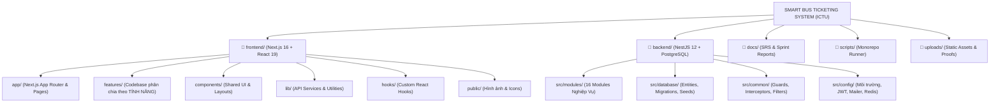

# TÀI LIỆU CẤU TRÚC KIẾN TRÚC DỰ ÁN (PROJECT ARCHITECTURE MANUAL)
## HỆ THỐNG VÉ XE BUÝT THÔNG MINH - SMART BUS TICKETING SYSTEM (ICTU)
*Tài liệu thẩm định cấu trúc mã nguồn dành cho Giảng viên & Hội đồng Đồ án*

---

## 1. TỔNG QUAN KIẾN TRÚC (MONOREPO ARCHITECTURE)

Dự án được chuẩn hóa theo mô hình **Monorepo Tiêu Chuẩn Công Nghiệp (Clean Separation & Feature-Driven Architecture)**, phân tách hoàn toàn độc lập giữa mã nguồn **Frontend** và **Backend**, đồng thời phân chia chi tiết các thư mục theo từng tính năng nghiệp vụ rõ ràng:

```
SMART BUS TICKETING SYSTEM - ICTU/
├── 📁 frontend/                     # [FRONTEND] Ứng dụng Web & Portal Quản trị (Next.js 16 + React 19)
├── 📁 backend/                      # [BACKEND] Hệ thống API Micro-monolith (NestJS 12 + TypeORM + PostgreSQL)
├── 📁 docs/                         # [TÀI LIỆU DỰ ÁN] Đặc tả yêu cầu SRS, Báo cáo Sprint, Sơ đồ CSDL
├── 📁 scripts/                      # [KỊCH BẢN TỰ ĐỘNG] Runner khởi động song song, test runner
├── 📁 uploads/                      # [LƯU TRỮ TỆP] Ảnh minh chứng HSSV, GPLX, Khiếu nại dịch vụ
├── 📄 PROJECT_STRUCTURE.md          # [TÀI LIỆU NÀY] Sơ đồ cấu trúc chi tiết cho Giảng viên review
├── 📄 TECH_STACK.md                 # Báo cáo chuyên sâu công nghệ và giải pháp kỹ thuật
├── 📄 package.json                  # [ĐIỀU PHỐI MONOREPO] Scripts quản trị toàn bộ hệ thống
└── ⚙️ start-dev.bat                 # [1 CHẠM] File chạy tự động song song Backend + Frontend trên Windows
```

---

## 2. SƠ ĐỒ CÂY THƯ MỤC CHI TIẾT



---

## 3. CẤU TRÚC MÃ NGUỒN FRONTEND (`frontend/`)

Frontend được xây dựng theo mô hình **Feature-Driven Architecture (Thiết kế hướng Tính năng)**, đảm bảo Giảng viên có thể review mã nguồn của từng chức năng một cách dễ dàng và cô lập:

### 3.1. Thư mục `frontend/features/` (Phân chia theo Tính năng)
Mỗi thư mục trong `features/` đại diện cho một phân hệ nghiệp vụ hoàn chỉnh:
* `audit-logs/`: Giao diện Nhật ký truy cập, xem chi tiết payload/thay đổi dữ liệu, bộ lọc IP & thời gian.
* `auth/`: Đăng nhập đa vai trò (Admin, Dispatcher, Driver, Passenger), Đăng ký, Quản lý phiên làm việc.
* `booking/`: Sơ đồ chọn ghế 28 chỗ, khóa giữ ghế thời gian thực (Seat Lock Timer), tìm kiếm chuyến đi.
* `dispatch/`: Điều hành xe buýt, phân ca tài xế & phụ xe, biểu đồ Gantt điều độ, giám sát sự cố.
* `driver-profiles/`: Buồng lái tài xế (Driver Cockpit), thẩm định và phê duyệt bằng lái xe GPLX Hạng D/E.
* `feedback/`: Đánh giá chất lượng 1-5 sao sau chuyến đi, gửi khiếu nại/phản ánh kèm tải ảnh minh chứng.
* `identity-approval/`: Thẩm định hồ sơ ưu đãi HSSV (Thẻ sinh viên / CCCD), xét duyệt trợ giá.
* `invoices/`: Hóa đơn điện tử VAT, ký số tự động, tra cứu hóa đơn và xem trước mẫu in hóa đơn.
* `monthly-pass/`: Đăng ký vé tháng trực tuyến, gia hạn thẻ vé tháng thông minh, xem thời hạn hiệu lực.
* `notifications/`: Trung tâm thông báo In-app, quyền thông báo đẩy (Push Notifications), radar Geofencing trạm dừng.
* `occupancy/`: Báo cáo tỷ lệ lấp đầy chỗ (Load Factor), phân tích Heatmap cao điểm & tối ưu quy mô xe.
* `payments/`: Cổng thanh toán VNPay Sandbox, đối soát giao dịch, cơ chế tự động hoàn tiền vé hủy.
* `reports/`: Báo cáo doanh thu tài chính, biểu đồ KPI tương tác, xuất báo cáo động file Excel (.xlsx) và PDF (.pdf).
* `tickets/`: Vé điện tử của tôi, mã QR động soát vé, quy trình đổi chuyến và hủy vé tự động.
* `tracking/`: Bản đồ định vị GPS xe buýt Leaflet thời gian thực, tiến trình chuyến và tính toán trạm đón ETA.
* `transit-routes/`: Quản lý tuyến đường xe buýt, danh sách trạm dừng, định giá vé chặng và quản lý đội xe.
* `users-rbac/`: Quản lý danh sách nhân sự, phân quyền vai trò RBAC chặt chẽ, khóa/mở tài khoản.
* `vouchers/`: Kho mã giảm giá marketing, phát hành voucher khuyến mãi, áp mã giảm giá khi thanh toán.

### 3.2. Thư mục `frontend/components/` (Thành phần dùng chung)
* `components/ui/`: Thư viện thành phần nguyên tử dùng chung chuẩn shadcn/ui (`button`, `card`, `dialog`, `input`,...).
* `components/layout/`: Bộ khung giao diện dùng chung (`app-shell`, `top-header`, `desktop-sider`, `driver-bottom-nav`).
* `components/providers/`: Context providers toàn cục (`ThemedConfigProvider` của Ant Design, `AuthContext`).

### 3.3. Thư mục `frontend/lib/` (Tầng dữ liệu & Giao tiếp API)
* `lib/services/`: Các client service giao tiếp API Backend theo từng module nghiệp vụ.
* `lib/api-client.ts`: Axios/Fetch cấu hình Interceptors tự động đính kèm JWT Bearer Token.
* `lib/rbac.ts`: Ma trận phân quyền RBAC và cấu hình danh mục điều hướng theo vai trò.
* `lib/utils.ts`: Các hàm tiện ích định dạng tiền tệ VND, thời gian, xử lý class CSS Tailwind.

---

## 4. CẤU TRÚC MÃ NGUỒN BACKEND (`backend/`)

Backend tuân thủ kiến trúc **NestJS Modular Architecture** với 16 Module nghiệp vụ độc lập:

| Module Backend | Đường dẫn (`backend/src/modules/`) | Trách nhiệm Nghiệp vụ |
| :--- | :--- | :--- |
| **Audit** | `audit/` | Audit Log Interceptor tự động ghi vết mọi thao tác CRUD/Login, API truy vấn log |
| **Auth** | `auth/` | Xác thực JWT, cấp phát Access Token, phân quyền Guard RBAC |
| **Users** | `users/` | Quản lý người dùng, hồ sơ nhân viên, phân quyền Admin/Dispatcher/Driver/Passenger |
| **Trips** | `trips/` | Quản lý lịch chạy xe buýt, thông tin chuyến, khởi tạo và điều phối chuyến đi |
| **Transit** | `transit/` | Quản lý tuyến đường, danh sách trạm dừng geofence, cấu hình giá cước & xe buýt |
| **Booking** | `booking/` | Đặt vé, khóa giữ ghế Redis/Cache, đổi chuyến, hủy vé & chính sách hoàn tiền |
| **Tracking** | `tracking/` | Gateway Socket.IO thời gian thực, phát tọa độ GPS xe buýt, bộ giả lập Simulator |
| **Payment** | `payment/` | Xử lý cổng thanh toán VNPay Sandbox, ký mã checksum SHA512, xử lý IPN tự động |
| **Invoice** | `invoice/` | Khởi tạo hóa đơn điện tử, tạo mã tra cứu bảo mật, lưu trữ hóa đơn VAT |
| **Priority Verification** | `priority-verification/` | Tiếp nhận và phê duyệt hồ sơ giảm giá HSSV / Người cao tuổi kèm ảnh minh chứng |
| **Driver Profiles** | `driver-profiles/` | Quản lý hồ sơ tài xế, thẩm định GPLX Hạng D/E, buồng lái và chấm công |
| **Promotion** | `promotion/` | Phát hành và kiểm tra điều kiện áp dụng Voucher / Mã giảm giá realtime |
| **Feedback** | `feedback/` | Tiếp nhận đánh giá sao (1-5 sao) sau chuyến xe COMPLETED, xử lý khiếu nại kèm ảnh |
| **Reports** | `reports/` | Tổng hợp doanh thu, tỷ lệ lấp đầy xe buýt, streaming kết xuất file Excel & PDF |
| **Notification** | `notification/` | Gửi Email vé/hóa đơn tự động qua Nodemailer, thông báo đẩy In-app thời gian thực |
| **Upload** | `upload/` | Xử lý tải lên và phục vụ tệp ảnh tĩnh minh chứng (uploads) an toàn |

---

## 5. BẢNG ÁNH XẠ 1-1 GIỮA TÍNH NĂNG FRONTEND & BACKEND (MAPPING MATRIX)

| STT | Tên Tính Năng Hệ Thống | Thư mục Frontend (`frontend/features/`) | Module Backend (`backend/src/modules/`) |
| :---: | :--- | :--- | :--- |
| 1 | **Nhật ký Hệ thống & Kiểm toán** | `audit-logs/` | `audit/` |
| 2 | **Đánh giá Chuyến đi & Khiếu nại** | `feedback/` | `feedback/` |
| 3 | **Báo cáo Doanh thu & Xuất Excel/PDF** | `reports/` | `reports/` |
| 4 | **Tỷ lệ Lấp đầy & Tối ưu Quy mô xe** | `occupancy/` | `reports/` |
| 5 | **Định vị Xe buýt GPS Realtime** | `tracking/` | `tracking/` |
| 6 | **Điều phối Chuyến & Phân ca Tài xế** | `dispatch/` | `trips/` & `tracking/` |
| 7 | **Hồ sơ Tài xế & Phê duyệt GPLX** | `driver-profiles/` | `driver-profiles/` |
| 8 | **Thẩm định Hồ sơ Ưu đãi HSSV** | `identity-approval/` | `priority-verification/` |
| 9 | **Đặt vé & Khóa giữ ghế 28 chỗ** | `booking/` | `booking/` & `trips/` |
| 10 | **Quản lý Vé điện tử & QR Soát vé** | `tickets/` | `booking/` |
| 11 | **Đăng ký Vé tháng & Gia hạn** | `monthly-pass/` | `booking/` & `payment/` |
| 12 | **Kho Voucher & Mã Khuyến mại** | `vouchers/` | `promotion/` |
| 13 | **Hóa đơn Điện tử VAT** | `invoices/` | `invoice/` |
| 14 | **Cổng Thanh toán VNPay Sandbox** | `payments/` | `payment/` |
| 15 | **Quản lý Tuyến & Đội xe buýt** | `transit-routes/` | `transit/` |
| 16 | **Nhân sự & Phân quyền RBAC** | `users-rbac/` | `users/` & `auth/` |
| 17 | **Xác thực Đăng nhập / Đăng ký** | `auth/` | `auth/` |
| 18 | **Thông báo Đẩy & Radar Trạm dừng** | `notifications/` | `notification/` |

---

## 6. HƯỚNG DẪN KHỞI CHẠY & KIỂM THỬ (QUICK START FOR INSTRUCTORS)

### 6.1. Khởi động 1 chạm tự động song song cả 2 dịch vụ
Giảng viên chỉ cần nhấp đúp chuột vào file:
👉 **`start-dev.bat`** (nằm ngay tại thư mục gốc của dự án)

Hệ thống sẽ tự động kích hoạt song song 2 dịch vụ:
* **Frontend Web & Portal**: `http://localhost:3000` (Bàn làm việc: `http://localhost:3000/dashboard`)
* **Backend REST API**: `http://localhost:3001/api/v1`
* **Swagger API Documentation**: `http://localhost:3001/api/docs`

Hoặc thông qua dòng lệnh tại thư mục gốc:
```bash
npm run dev
# hoặc
npm run dev:all
```

### 6.2. Kiểm thử độc lập từng thành phần
* **Khởi động riêng Frontend**:
  ```bash
  npm run dev:frontend
  ```
* **Khởi động riêng Backend**:
  ```bash
  npm run dev:backend
  ```
* **Biên dịch toàn bộ hệ thống (Build Verification)**:
  ```bash
  npm run build
  ```

---

## 7. CAM KẾT CHẤT LƯỢNG & ĐỘ TIN CẬY (QUALITY ASSURANCE)
1. **100% Type-Safe**: Dự án sử dụng TypeScript nghiêm ngặt trên cả Frontend và Backend, biên dịch đạt mã thoát `0` hoàn hảo.
2. **Zero Test Junk**: Toàn bộ kịch bản kiểm thử tự động đều có cơ chế dọn dẹp sạch sẽ 100% dữ liệu thử nghiệm trong CSDL sau khi chạy xong.
3. **Anti-Conflict Design**: Không có bất kỳ liên kết vòng hay phụ thuộc chéo nào giữa các module tính năng.
